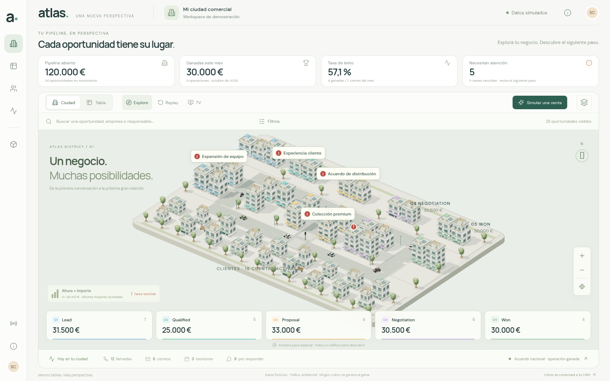
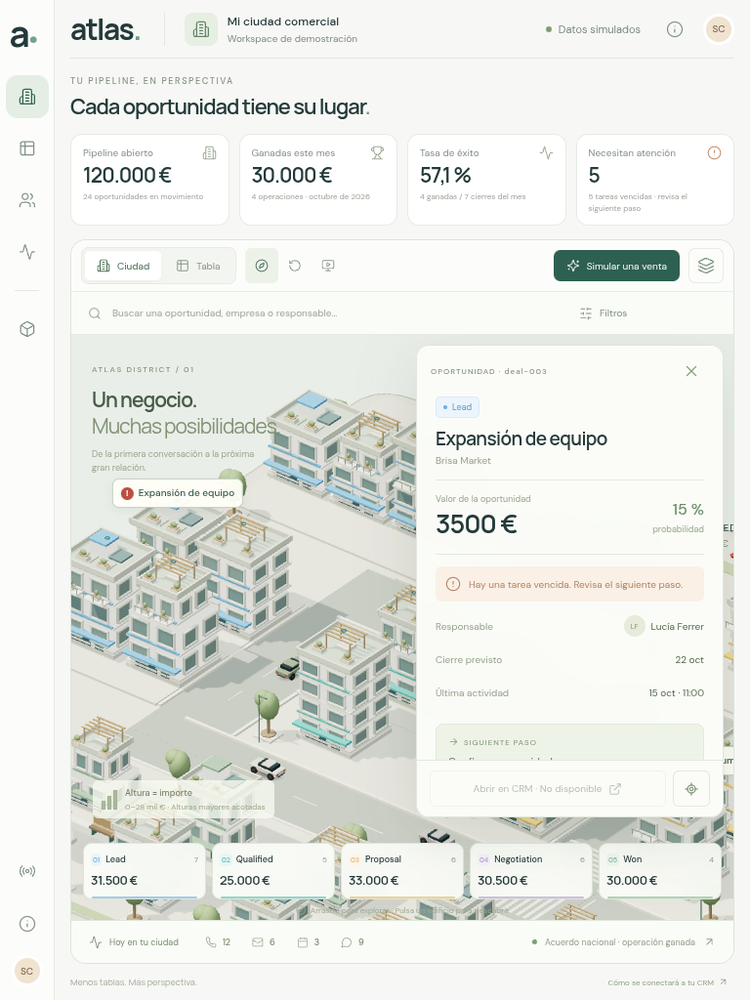
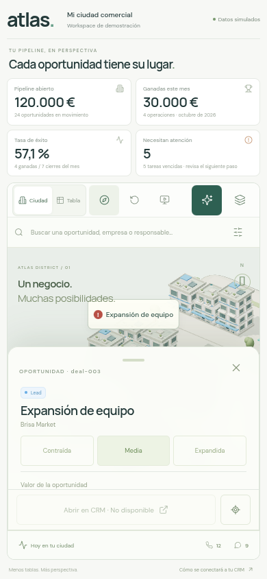

# Atlas · Ciudad CRM

Esta versión usa una ciudad 3D real de Three.js y un proveedor CRM ficticio independiente del renderer. Las capturas de esta carpeta se obtienen de Chromium ejecutando la aplicación; no son imágenes generadas, fondos ni la referencia presentada como resultado.

## Referencias y alcance

La URL facilitada, `https://pipeline-city.vercel.app/`, devolvió un bloqueo de acceso HTTP 403 en este entorno. No se afirma haber comprobado sus controles ni su renderizado 3D. Se implementan las definiciones funcionales explícitas del documento adjunto. No se recibió una imagen nueva con este último documento; por tanto, la dirección artística se interpreta a partir de su descripción escrita y no se presenta como una réplica inspeccionada.

Todos los registros muestran **Datos simulados**. El tráfico es ambiental: sus coches no son ventas, llamadas, repartos ni movimientos de trabajadores. Ganar una oportunidad no registra facturas, cobros o beneficios. Los enlaces CRM que no existen se presentan como **No disponible**.

## Reproducción

```sh
npm ci --cache /tmp/atlas-npm-cache
npm run dev
```

Para validar la compilación, ejecutar `npm run build`, iniciar `npm run preview -- --port 4173 --strictPort` y ejecutar `BASE_URL=http://127.0.0.1:4173 node tests/city-browser.mjs`. `npm test` valida los modelos sin necesitar GPU.

## Capturas reales







Más evidencia: [escritorio](captures/desktop.png), [móvil horizontal](captures/mobile-landscape.png), [desplazamiento del contenido de la ficha horizontal](captures/mobile-landscape-scroll.png), [movimiento reducido](captures/reduced-motion.png) y [tabla sin WebGL](captures/fallback.png).

**[Ver la grabación real de la demo](captures/city-demo.mp4)** · 11,04 segundos, 1280 × 800, preset ligero. Se capturaron 20 frames reales del compositor de Chromium mediante CDP y se codificaron con FFmpeg conservando sus timestamps. El clip muestra selección, un evento ficticio ganado y la tabla. No contiene frames inventados ni interpolación externa; su baja cadencia está condicionada por SwiftShader. [Metadatos del vídeo](video-capture.json).

## Comprobaciones funcionales

- **Datos reproducibles:** 24 abiertas por 120.000 €, 4 ganadas por 30.000 €, 3 perdidas archivadas, 18 clientes, 7 contactos pendientes, 9 conversaciones pendientes, 12 llamadas hoy y 5 tareas vencidas. Las cuentas y actividades no se suman como oportunidades.
- **Selección real:** clic en la geometría del edificio mediante raycasting. Se comprueba que el píxel pertenece al canvas y que el edificio no está tapado por otro, evitando presentar un clic en una etiqueta HTML como selección 3D.
- **Cambios de negocio:** el control de etapa actualiza el registro y conserva los UUID de los meshes y geometrías compartidos. Ganar una oportunidad reutiliza la cuenta existente; repetir el evento no vuelve a sumar importes ni crear clientes. La parcela de destino queda libre de otro centro de edificio.
- **Representaciones sincronizadas:** la suma de las celdas de importe de la tabla coincide con los indicadores de abiertas y ganadas. Cada filtro de etapa reproduce el número y el importe de su tarjeta de barrio. Se verifican búsqueda, responsable, atención y archivo de perdidas.
- **Modos:** TV conserva los datos. Replay permite avance, pausa y velocidad ×4; salir restaura el snapshot, la selección y los filtros anteriores. Se valida un proceso con seis etapas, una etapa adicional de revisión y un ID distinto para la etapa ganada (`signed`).
- **Responsive:** 1440 × 900, 768 × 1024, 390 × 844 y 844 × 390. Sin scroll horizontal accidental. Las tres alturas de ficha alcanzan sus dimensiones finales antes de medir o capturar; la ficha se cierra mediante su botón real. La cámara deja el edificio seleccionado fuera de la superficie cubierta por el panel.
- **Táctil emulado:** Chromium con `hasTouch` e `isMobile`; tap mediante `touchscreen.tap` y arrastre mediante eventos táctiles CDP. El tap selecciona y el arrastre orbita sin abrir una ficha. También se activa y comprueba la preferencia de movimiento reducido.
- **Sin WebGL:** se fuerza a `getContext` a devolver `null` para WebGL. Se conserva la tabla con 28 registros, búsqueda y selección. El aviso no bloquea la aplicación.
- **Modelos:** `npm test` incluye 41 pruebas: 17 de ciudad y tráfico, más 24 de las experiencias anteriores. Las tres pruebas de navegador anteriores también se conservaron y pasaron durante la implementación.

La ejecución final completa terminó con **13 grupos de integración correctos y cero errores JavaScript no capturados**: [browser-validation.json](browser-validation.json). Una comprobación adicional del último ajuste de paisaje verificó 279 px de cuerpo desplazable, el importe visible, que la ficha recibe los clics en el área donde antes se superponía la barra y que su botón cierra: [landscape-validation.json](landscape-validation.json). También se comprueba la visibilidad de la geometría real al desactivar tráfico, su pausa y ocultación en Ligera y su restauración en Alta, sin alterar las métricas.

**No se dispone de un teléfono físico ni se afirma haber probado gestos en hardware táctil real.** Las comprobaciones de calles y tráfico cubren el grafo de la demo; no equivalen a un simulador general de circulación urbana.

La compilación Vite es correcta. Conserva la advertencia de un chunk compartido de Three.js de aproximadamente 604 kB; no se ha silenciado ni se presenta como una optimización completada.

## Interpretación del rendimiento

**Entorno medido:** Linux, Chromium 154.0.8037.57, ANGLE/Vulkan SwiftShader, GPU por software, DPR nativo 1. Se registran 30 intervalos entre callbacks de `requestAnimationFrame` después de 10 callbacks de calentamiento por caso, con la escena en funcionamiento. Son muestras pequeñas de cadencia del navegador headless, no FPS de una pantalla física. El tiempo CPU de enviar comandos tampoco equivale a FPS.

| Viewport          | Preset      | Canvas interno | DPR efectivo |  Mediana |       p95 | Calls del frame | Triángulos del frame |
| ----------------- | ----------- | -------------- | -----------: | -------: | --------: | --------------: | -------------------: |
| 1920 × 1080       | Equilibrada | 1778 × 698     |            1 | 983,3 ms | 1999,9 ms |             100 |              205.938 |
| 1920 × 1080       | Ligera      | 1778 × 698     |            1 | 950,0 ms | 1049,9 ms |              21 |              190.164 |
| 1920 × 1080       | Alta        | 1778 × 698     |            1 | 966,7 ms | 1383,3 ms |             100 |              205.938 |
| 390 × 844 emulado | Ligera      | 368 × 412      |            1 | 300,0 ms |  533,3 ms |              21 |              190.164 |

Las llamadas y triángulos corresponden al contador del último frame de cada muestra. Las sombras estáticas se cachean: estos valores no describen el coste de recalcularlas durante una transición. El preset ligero conserva la resolución nativa y reduce tráfico, sombras y piezas pequeñas antes de reducir nitidez. El DPR nativo 1 de esta prueba no activa los límites superiores de Alta en pantallas con mayor densidad. Los tiempos de Alta y Equilibrada no muestran una ventaja significativa entre sí en este equipo por software.

**Los objetivos de 60 FPS en escritorio y 30 FPS en móvil no se alcanzan en SwiftShader ni se acreditan en hardware real.** Es necesario medir y optimizar posteriormente en una GPU de referencia y en teléfonos físicos. Se conserva la evidencia completa, las muestras y los SHA-256 de los archivos fuente en [performance.json](performance.json). Un último cambio CSS afecta exclusivamente al apilado del panel en horizontal con altura ≤600 px; no afecta a los viewports medidos ni al clip y se verificó mediante una recarga separada de esa orientación.

Capturas por preset: [Equilibrada](captures/quality-balanced.png), [Ligera](captures/quality-light.png), [Alta](captures/quality-high.png) y [Ligera móvil emulada](captures/quality-mobile-light.png).

No hay conexión CRM, OAuth, GPS ni permisos de servidor en esta demo. El contrato de proveedor permite sustituir la fuente, pero esa sustitución necesita un backend que preserve procedencia, sincronización y permisos.
