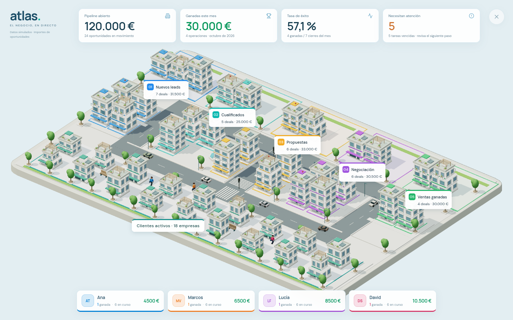

# Atlas · TV, barrios y equipo comercial

Esta actualización conserva el proveedor CRM ficticio y cambia su representación visual: TV ocupa todo el viewport, las etapas tienen colores y títulos más claros, los edificios se desmontan y reconstruyen, y cuatro comerciales recorren la ciudad con su cartera y sus ventas.

## Resultado visual



TV oculta la navegación, los menús, los filtros, la tabla y las fichas. Mantiene los cuatro indicadores arriba y el resumen comercial abajo. Solicita el modo nativo de pantalla completa cuando el navegador lo permite; la presentación completa también funciona si el navegador lo deniega. **Escape** o la **X** permiten salir y recuperar la vista, la selección y los filtros anteriores. El modo no modifica los datos del CRM.

Los cinco barrios muestran **Nuevos leads, Cualificados, Propuestas, Negociación y Ventas ganadas**, con numeración, color, cantidad e importe. Los clientes tienen su propio rótulo. Las placas usan sus dimensiones reales para evitar superponerse; los avisos rojos ceden espacio a los títulos. La cámara vertical de TV adapta la orientación de la ciudad para aprovechar la altura disponible.

Más capturas reales: [ciudad normal](captures/city-overview.png), [TV vertical emulado](captures/television-mobile.png), [equipo en escritorio](captures/sales-team-desktop.png), [equipo en móvil emulado](captures/sales-team-mobile.png) y [TV con movimiento reducido](captures/reduced-motion-tv.png).

## Obras y comerciales

Un cambio de etapa inicia una coreografía nominal de 12 segundos: desmontaje con grúa, traslado de materiales por las calles y construcción en la nueva parcela. El edificio conserva su identidad y permanece en la parcela de origen o destino; durante el transporte sus piezas están ocultas. El camión lleva paneles y materiales. Se permiten dos obras simultáneas; el resto queda en cola. El registro comercial se actualiza con el evento, sin esperar a que termine la animación.

**[Ver la grabación real de la obra](captures/construction-demo.mp4)** · **18,68 segundos, 1280 × 800**. Son **26 frames reales** del compositor de Chromium, codificados con FFmpeg y sus timestamps originales. El registro recoge las tres fases `deconstruct`, `transport` y `build`, junto con el estado del responsable durante el cierre. No se aceleró el reloj del modelo para producir estas evidencias. [Metadatos del vídeo](video-capture.json).

Detalles de la escena: [desmontaje](captures/detail-deconstruct.png), [camión en tránsito](captures/detail-transport.png) y [construcción](captures/detail-build.png). También se conservan las tres fases en el encuadre general: [origen](captures/construction-deconstruct.png), [tránsito](captures/construction-transport.png), [destino](captures/construction-build.png).

Ana, Marcos, Lucía y David tienen colores propios, cuerpo articulado, tablet y maletín. Visitan cuentas y oportunidades asignadas; un cierre registrado los dirige hacia el cliente y la nueva sede. Un clic real sobre una persona abre su equipo y cartera. Los recorridos son una interpretación ilustrativa del responsable y la etapa, sin atribuirles una ubicación real. Caminar o terminar una obra no genera ventas.

El recuento de cada comercial procede del mismo proveedor que la tabla y los indicadores: oportunidades abiertas y ganadas del mes, con sus importes. La demo inicial suma **4 ganadas por 30.000 €**; ganar `deal-001` añade una sola operación y **1.500 €** al responsable correspondiente. Repetir el evento no suma otra venta ni reinicia la obra. Las capturas muestran distintas sesiones de prueba, algunas después de ese cierre ficticio.

## Verificación

- **55 pruebas de modelos:** reglas CRM y tráfico, ocho pruebas de obras, seis de comerciales y las experiencias anteriores.
- **10 grupos nuevos de navegador:** cuatro comerciales identificados en movimiento; selección por su geometría real; TV completa y restauración; rechazo del fullscreen nativo; seis rótulos sin solapes; tres fases de construcción con identidad estable; venta y recuento por responsable sin duplicados; panel de equipo; TV y equipo en móvil emulado; movimiento reducido. [Resultado completo](browser-validation.json).
- **13 grupos de regresión:** métricas iniciales, raycasting de edificios, identidad de geometrías, cierre idempotente, tabla y filtros sincronizados, Replay, tráfico, etapas configurables, tres viewports, gestos táctiles emulados y tabla funcional sin WebGL. [Resultado completo](regression-validation.json). [Ejemplo de fallback](regression-captures/fallback.png).
- **2 comprobaciones finales de TV vertical:** canvas completo, indicadores y equipo dentro de pantalla, ciudad con altura útil y movimiento reducido. Se proyectan 46 entidades visibles; sus centros ocupan **268,2 px de altura** en el viewport emulado de **390 × 844**. [Resultado dirigido](portrait-validation.json).

Las suites completas de 10 y 13 grupos se ejecutaron antes del último ajuste exclusivo del encuadre y las placas de TV vertical. Ese ajuste se validó después mediante las dos comprobaciones dirigidas, la captura normal y la de movimiento reducido. El perfil y el vídeo usan las fuentes finales. Todas estas ejecuciones terminaron con **cero errores JavaScript no capturados**.

Las capturas proceden de Chromium ejecutando el renderer WebGL real. La GPU es SwiftShader por software. Los tamaños móviles y los gestos son emulados; no se dispone de pruebas en un teléfono físico.

## Rendimiento registrado

Una única medición de TV con preset **Ligera**, tras 10 callbacks de calentamiento, registra 30 intervalos de `requestAnimationFrame`:

| Viewport | Canvas interno | Mediana | p95 | Llamadas del último frame | Triángulos del último frame |
| --- | --- | ---: | ---: | ---: | ---: |
| 1280 × 800 | 1280 × 800 | 1.066,6 ms | 1.866,5 ms | 105 | 194.340 |

Chromium **154.0.8037.57**, ANGLE/Vulkan SwiftShader, GPU por software. Se mide la cadencia del navegador headless con la escena en funcionamiento; estos valores no son FPS de una pantalla física ni acreditan 60/30 FPS en hardware. El preset ligero desactiva el tráfico, pero conserva a los comerciales. [Muestras, renderer y SHA-256 de las siete fuentes finales](performance.json).

## Reproducir

```sh
npm ci --cache /tmp/atlas-npm-cache
npm test
npm run build
npm run preview -- --port 4173 --strictPort
```

Con el servidor activo, en otra terminal:

```sh
node tests/city-v2-browser.mjs
CAPTURE_DIR=docs/city/v2/regression-captures RESULT_PATH=docs/city/v2/regression-validation.json node tests/city-browser.mjs
PORTRAIT_ONLY=1 node tests/city-v2-browser.mjs
node tools/capture_city_v2.mjs
```

Los scripts de navegador usan `/usr/bin/chromium`; puede indicarse otra ruta mediante `CHROMIUM_PATH` y otro servidor mediante `BASE_URL`. La grabación utiliza los binarios locales `ffmpeg` y `ffprobe`. `VIDEO_ONLY=1 node tools/capture_city_v2.mjs` permite volver a grabar sin repetir el perfil.

Todos los datos siguen siendo simulados. Las ganadas son oportunidades comerciales cerradas; no representan cobros, facturas ni beneficio. Esta actualización no incorpora una conexión real a un CRM.
