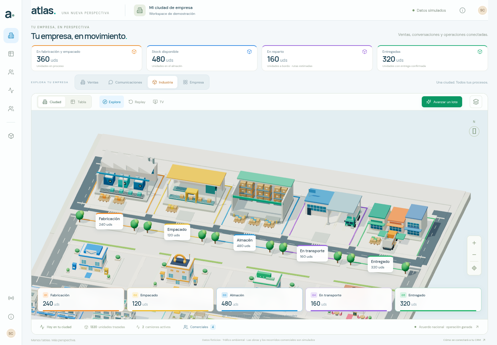
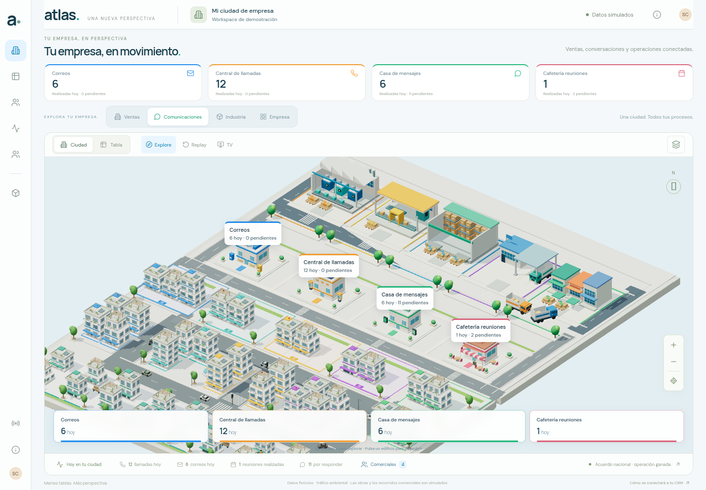

# Atlas · Comerciales, comunicaciones e industria

Esta ampliación mantiene una sola escena 3D y permite explorar **Ventas**, **Comunicaciones**, **Industria** y la vista conjunta **Empresa**. Las capturas proceden de la aplicación ejecutándose en Chromium con WebGL; todos los registros de negocio son ficticios, con fecha de referencia **16 de octubre de 2026**.

## Resultado visual





Las cuatro iniciales de los comerciales se ven sobre sus avatares: **AT**, **MV**, **LF** y **DS**. Durante las obras la insignia añade nombre y contexto. El caso comprobado cambia `deal-001` de Lead a Cualificados: Ana visita el origen, llega al destino y permanece durante la reconstrucción, sin registrar una venta. El diagnóstico recoge `atDestination: true`, `sourceVisited: true` y `attendanceStatus: ready` durante el montaje.

Evidencia: [cuatro comerciales identificados](captures/sales-owner-badges.png), [Ana junto a la obra de una etapa abierta](captures/non-won-construction-with-owner.png) y [vista de toda la empresa](captures/whole-company.png).

## Contadores y trazabilidad

Los locales muestran actividades registradas y separan realizadas y pendientes. Las previstas no aumentan el número de reuniones realizadas. Las conversaciones genéricas conservan su canal.

| Canal                    | Realizadas hoy en la demo | Pendientes |
| ------------------------ | ------------------------: | ---------: |
| Correo                   |                         6 |          0 |
| Llamadas                 |                        12 |          0 |
| WhatsApp                 |                         6 |          2 |
| Conversaciones genéricas |                         0 |          9 |
| Reuniones                |                         1 |          2 |

Se seleccionaron los **cuatro edificios mediante raycasting 3D**, comprobando que el píxel pertenecía al canvas y que el local devolvía su ID. Cada panel mostró el número de registros correspondiente: [correo](captures/email-records.png), [mensajes y desglose de canales](captures/messages-records.png), [cafetería y sus reuniones](captures/cafeteria-records.png). También se conserva el [detalle de la cafetería](captures/cafeteria-detail.png).

El dominio industrial contiene **10 lotes de un mismo producto, 3 camiones y 1.320 unidades**. Cada lote pertenece a una sola etapa:

| Etapa         | Unidades iniciales |
| ------------- | -----------------: |
| Fabricación   |                240 |
| Empacado      |                120 |
| Almacén       |                480 |
| En transporte |                160 |
| Entregado     |                320 |

Los números de las cinco instalaciones coinciden con los lotes del proveedor. El stock inicial es **480**, exclusivamente lo que está en almacén. Los palés y cajas son muestras visuales limitadas; la cantidad exacta procede del lote, no del número de objetos dibujados. [Panel de almacén](captures/warehouse-ledger.png).

Se recorrió mediante los botones reales el lote `batch-001`, de **120 unidades**: fabricación → empacado → almacén → transporte → entregado. El Camión 03, con **Pablo Ríos**, mantuvo su UUID mientras se desplazaba con ese lote. La entrega explícita aumentó las entregadas de **320 a 440**, vació el vehículo y se registró una sola vez. Repetir el evento no añadió otra entrega. Las **1.320 unidades** se conservaron en cada paso y el proveedor comercial permaneció idéntico.

Después se publicaron por separado el regreso vacío y la llegada al almacén. [Camión con carga y trazabilidad](captures/truck-cargo-record.png) · [regreso vacío](captures/truck-empty-return.png). La animación y la estimación del trayecto no publican eventos de entrega.

## Comprobaciones realizadas

- **86 pruebas de modelos**, ejecutadas con `npm test`: reglas CRM y tráfico, comunicaciones por canal y fecha, obras con presencia del responsable y colas, rutas de comerciales y conservación industrial.
- **15 grupos nuevos de navegador**, todos correctos: insignias; contadores de comunicaciones; selección 3D de los cuatro locales; cinco etapas y diez lotes; selección de instalaciones; flujo productivo y movimiento del camión; ausencia de entrega automática; entrega idempotente; regreso vacío; presencia del comercial en una obra no ganada; vista Empresa; TV industrial y Replay con restauración; móvil; movimiento reducido; paneles sin WebGL. [Informe completo](browser-validation.json).
- **13 grupos de regresión**, todos correctos: métricas iniciales, selección de edificios, identidad de geometrías, eventos duplicados, tabla y filtros, Replay, tráfico, etapas configurables, escritorio/tableta/móvil, gestos táctiles emulados y tabla sin WebGL. [Informe de regresión](regression-validation.json).
- **3 comprobaciones dirigidas finales**, todas correctas: TV de escritorio y móvil con cinco placas industriales visibles, dentro de pantalla y sin cubrir los indicadores; tres posiciones finales de camión distintas y seleccionables por su ID. Las separaciones medidas fueron **3,4 m, 6,8 m y 3,4 m**. [Informe final y SHA-256 de once fuentes](supplementary-validation.json).

Las suites de **15 y 13 grupos** se completaron antes del último ajuste exclusivo de aparcamiento de los camiones. Ese ajuste se validó después con las **tres comprobaciones dirigidas**. Las capturas de TV se actualizaron tras esperar al final del movimiento de cámara y dos frames adicionales, para registrar sus cinco placas. Los informes completos conservan los hashes de sus fuentes; el informe dirigido contiene los hashes finales. Todas las ejecuciones terminaron con **cero errores JavaScript no capturados**.

La comprobación del extremo de ruta es un **diagnóstico controlado del renderer**: se observa su reloj visual, se muestrea el final con los vehículos detenidos y después se restaura. No se adelanta el reloj del ERP ni se publica una llegada. Para comprobar los tres aparcamientos se despacha explícitamente otro lote a la flota y se verifica que seleccionar cada camión no modifica ese estado. Este diagnóstico no representa un viaje real ni una entrega confirmada.

## TV, móvil y compatibilidad

TV industrial muestra unidades y flota, con el canvas ocupando todo el viewport y los menús ocultos. Salir recupera distrito, selección y panel. Entrar en Replay desde Industria cambia temporalmente a Ventas y restaura Industria y ambos proveedores al salir.

Capturas finales: [TV industrial de escritorio](captures/tv-industry.png), [TV industrial vertical](captures/mobile-industry-tv.png), [almacén en móvil](captures/mobile-warehouse.png), [cafetería en móvil](captures/mobile-cafeteria.png), [industria con movimiento reducido](captures/reduced-motion-industry.png) y [registros industriales sin WebGL](captures/fallback-industry-records.png).

Los casos nuevos usan **1440 × 1000** y **390 × 844**. La regresión añade **1440 × 900**, **768 × 1024** y **844 × 390**, con tap y arrastre táctil emulados. No se probó un teléfono físico. Con movimiento reducido los cambios de parcela se completan sin obra animada y los vehículos permanecen estables. Al forzar WebGL a fallar, siguen disponibles los paneles de mensajes e industria.

Chromium **154.0.8037.57**, ANGLE/SwiftShader por software. No se repitieron perfiles de rendimiento ni grabaciones en esta ampliación. Las mediciones de V2 corresponden a su escena y no acreditan FPS de V3 ni objetivos de 60/30 FPS en hardware físico.

## Reproducir

```sh
npm ci --cache /tmp/atlas-npm-cache
npm test
npm run build
npm run preview -- --port 4173 --strictPort
```

Con el servidor activo, en otra terminal:

```sh
node tests/city-v3-browser.mjs
CAPTURE_DIR=docs/city/v3/regression-captures RESULT_PATH=docs/city/v3/regression-validation.json node tests/city-browser.mjs
TV_ONLY=1 node tests/city-v3-browser.mjs
```

Los scripts usan `/usr/bin/chromium`; `CHROMIUM_PATH` permite elegir otro binario y `BASE_URL` otro servidor. Las pruebas nuevas escriben únicamente evidencia V3; la regresión usa una carpeta y un informe propios para conservar la evidencia anterior.

Los recorridos son ilustrativos y no proceden de GPS. Los datos no están conectados a una bandeja, WhatsApp, CRM o ERP reales. Una entrega y una oportunidad ganada no generan automáticamente facturas, cobros ni beneficio.
