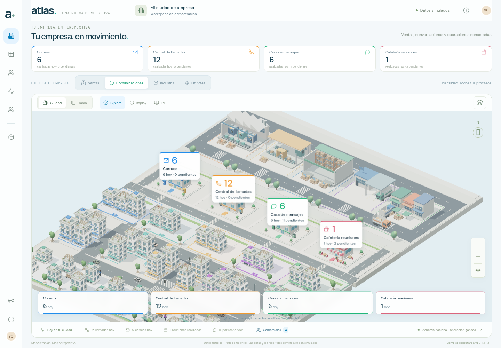
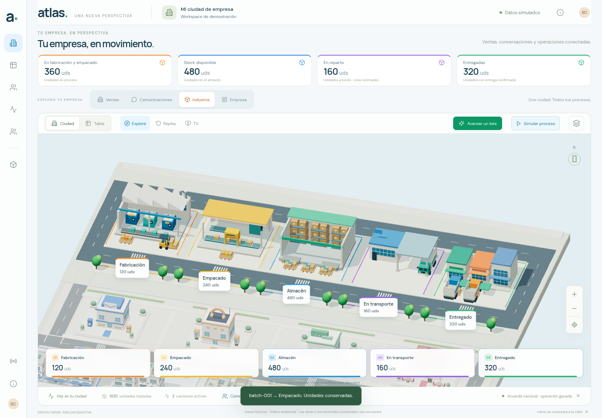
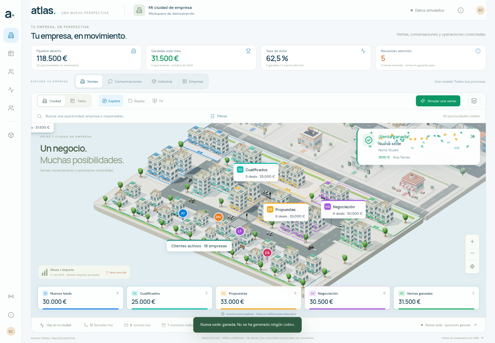

# Atlas · Calidad visual y movimiento

La evidencia procede de Chromium 154 con WebGL2 y ANGLE/SwiftShader por software. Las capturas muestran la aplicación ejecutándose, no composiciones ni imágenes generadas. Los datos CRM/ERP permanecen ficticios.

## Evidencia visual







Las etiquetas de comerciales conservan su contenido DOM mientras pasean y proyectan la posición en cada frame, con coordenadas de tres decimales. Los contadores y el contenido se reconstruyen cuando cambian los datos. Las capas del suelo industrial, calzada, pintura y parcelas tienen alturas distintas; las pruebas comprueban también que las superficies coplanares no se solapan.

Los cuatro pasos industriales se verifican tras eventos explícitos: fabricación → empacado → almacén → transporte → entregado. Para capturar la carretilla a mitad de camino se detiene el renderer, se muestrea su reloj visual al 50 % y se renderiza con WebGL. Se espera primero a que los rótulos reflejen el evento. Este muestreo no adelanta el reloj del proveedor ni publica producción, llegadas o entregas. Cada paso conserva las 1.320 unidades, su identidad y el estado comercial.

La simulación automática sólo publica comandos ficticios al pulsar **Simular proceso**; se puede pausar. La animación de máquinas, cintas, carretillas y rutas no modifica por sí misma el inventario.

## Comprobaciones

- **108 pruebas de modelos y componentes**, todas correctas con `npm test`.
- **10 grupos V4 de navegador**, todos correctos: etiquetas, comunicaciones, enfoque por distrito, suelo, cuatro traslados industriales, simulación, TV, celebraciones, móvil y movimiento reducido. [Informe](browser-validation.json).
- **15 grupos de regresión V3**, todos correctos: selección 3D de locales, instalaciones y camiones; cantidades y trazabilidad; obras con presencia del comercial; Empresa, TV, Replay, móvil, movimiento reducido y paneles sin WebGL. [Informe](v3-regression/browser-validation.json).
- **6 grupos dirigidos finales**, todos correctos: venta y entrega visibles con partículas; cancelación al reiniciar antes del primer paint; regreso y llegada de camiones bloqueados en Replay pero operativos en vivo; cambio de viewport durante un vuelo TV; movimiento reducido sin partículas. [Informe final](final-target-validation.json).

Las 25 comprobaciones de navegador principales usan el primer build V4, `app-DAkCKZen`. Después se reforzaron cuatro archivos: `app.js` protege regreso y llegada durante Replay; `scene.js` conserva proporción y encuadre al redimensionar durante un vuelo; `celebrations.js` inicia el autocierre después de dos callbacks de frame; `celebrations.css` mantiene la tarjeta visible desde el principio y las partículas por encima. Los seis grupos dirigidos y la medición de rendimiento usan el build final `app-BGT4DxNP`.

Los informes conservan SHA-256 de sus fuentes o assets. En el informe de regresión V3, `sourceSha256` identifica el código del build comprobado a través del informe V4; `workingTreeSourceSha256AtCompletion` conserva la lectura original del árbol de trabajo, donde se estaban preparando las correcciones finales mientras seguía sirviéndose el build previo. La evidencia de las versiones anteriores se conserva. Todas estas ejecuciones terminaron con **cero errores JavaScript no capturados**.

El caso TV comprueba el primer cambio real de Empresa a Ventas, transiciones de siete segundos, descanso de nueve segundos, pausa de catorce segundos al navegar y restauración al salir. La secuencia configurada vuelve a Empresa entre Ventas, Comunicaciones e Industria. El recorrido completo no se fuerza acelerando el reloj.

Las celebraciones se comprueban con una venta y una entrega efectivamente aplicadas. Repetir el evento no crea otra celebración. Replay, el estado inicial y Reiniciar no celebran cierres antiguos. Con movimiento reducido se conserva el aviso sin partículas y no se ejecuta el recorrido TV.

Las fotos finales de celebraciones muestrean a **500 ms las animaciones CSS reales**, pausadas para que la captura no pierda las piezas durante el costoso screenshot por software. Antes de la foto se deja actualizar el renderer hasta que los rótulos coinciden con el proveedor y el énfasis del distrito está asentado; después se detiene la escena de fondo durante esa evidencia; los eventos, el DOM y el temporizador real de cierre se mantienen. Se verifican 36 partículas y opacidad 1 antes de la captura y la presencia de la tarjeta después. [Venta](captures/sale-celebration.png) · [Entrega](captures/delivery-celebration.png) · [Aviso sin partículas](captures/reduced-motion-sale-celebration.png). [Comprobación específica de las fotos y sus rótulos](celebration-pictures-validation.json).

En el cambio de viewport TV se espera a que el backing buffer del renderer adopte el nuevo tamaño: ResizeObserver se ejecuta después de los callbacks RAF y antes de pintar. Un muestreo previo a esa señal aún puede observar la proporción antigua. Después de la señal se verifican tres frames consecutivos en movimiento, con proporción `390/844`, matriz finita y sin eventos de negocio. [Diagnóstico](tv-resize-diagnostic.json) · [Captura](captures/mobile-tv-resized-during-tour.png).

Se cubren 1440 × 1000 y 390 × 844. Móvil y movimiento reducido son emulados; no se probó un teléfono físico. El cierre de una celebración se verifica mediante el handler de su botón: esperar dos frames estables en el renderer por software puede exceder sus 5,6 segundos de duración.

## Medición de rendimiento

La referencia previa se midió sobre el build V3 de `bf8a9dc`, antes de reconstruir V4. [Referencia](baseline-performance.json). El método se repite con la misma ventana 1280 × 800, preset Ligera, vista Industria, cinco callbacks de calentamiento y veinte intervalos de `requestAnimationFrame`. La observación de etiquetas usa otros veinte frames en Ventas. No hay otros navegadores usando WebGL durante las mediciones.

| Medida                                                   | Referencia V3 |    V4 final |
| -------------------------------------------------------- | ------------: | ----------: |
| Mediana de 20 intervalos RAF                             |      433,3 ms |    400,0 ms |
| Percentil 95 de esos intervalos                          |      483,3 ms |  1.216,7 ms |
| Mediana de envío JS del diagnóstico                      |        5,4 ms |      2,2 ms |
| Llamadas de dibujo                                       |            61 |          64 |
| Triángulos                                               |       215.358 |     215.718 |
| Mutaciones del contenido de la insignia de Ana en 20 RAF |            38 |           0 |
| Píxeles internos del canvas                              |   1.162 × 405 | 1.162 × 405 |

La mediana de esta muestra baja, pero **el percentil 95 empeora**. No se interpreta como una mejora uniforme de los tiempos de frame. Los veinte valores completos de ambas ejecuciones se conservan, sin repetir la medición para sustituir los picos. El envío JS es el diagnóstico acumulado del renderer al terminar la muestra, no un cronómetro exclusivo de esos veinte callbacks.

La medición por software no acredita 60/30 FPS en una pantalla física. Los intervalos incluyen la planificación del navegador y del sistema; una muestra corta permite comparar esta ejecución controlada, no garantizar una velocidad en todos los dispositivos. Los informes incluyen píxeles internos, llamadas, triángulos, tiempos de envío JavaScript y el identificador del renderer.

## Reproducir

```sh
npm ci --cache /tmp/atlas-npm-cache
npm test
npm run build
npm run preview -- --port 4173 --strictPort
```

En otra terminal, ejecutar en serie:

```sh
node tests/city-v4-browser.mjs
FINAL_TARGET_ONLY=1 node tests/city-v4-browser.mjs
CAPTURE_DIR=docs/city/v4/v3-regression node tests/city-v3-browser.mjs
node tools/measure_city_v4.mjs
```

`BASE_URL` y `CHROMIUM_PATH` permiten cambiar servidor y navegador. `CELEBRATION_CAPTURES_ONLY=1 node tests/city-v4-browser.mjs` actualiza sólo las dos fotos de hitos, conservando los seis grupos del informe final. `HANDOFF_ONLY=1 node tests/city-v4-browser.mjs` repite sólo los cuatro traslados y actualiza sus capturas, dejando el informe principal intacto. `BENCHMARK_PHASE=baseline` genera una nueva referencia: sólo debe ejecutarse sobre el build que se pretenda utilizar como referencia, nunca para sustituir retrospectivamente la evidencia V3 original.
