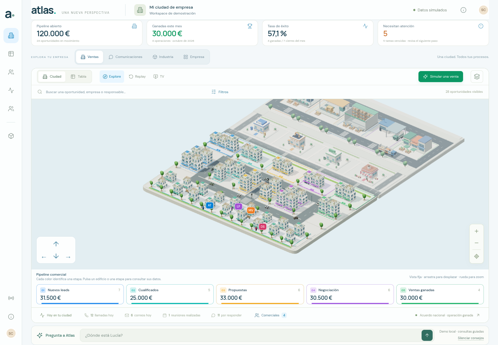
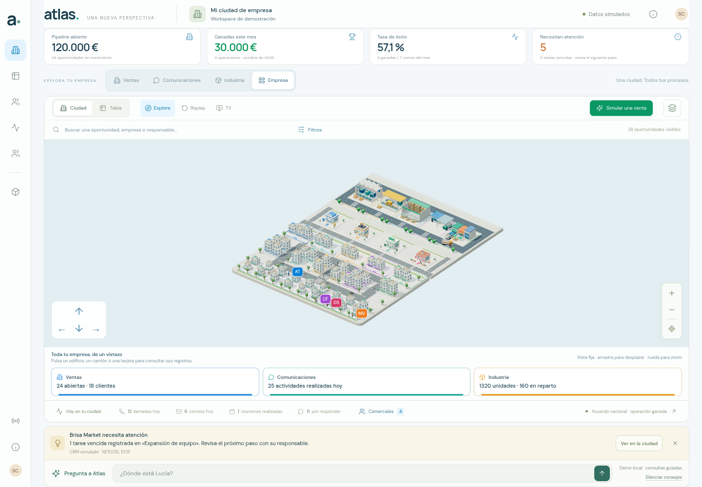

# Atlas · Mapa fijo y asistente

La aplicación se comprobó en Chromium 154 con WebGL2 y ANGLE/SwiftShader por software, en 1440 × 1000 y con móvil emulado de 390 × 844. Las imágenes son capturas del navegador. No se midieron FPS nuevos ni se probó un teléfono físico.





## Comprobaciones

Se completaron **7 grupos de navegador en la primera compilación** y **2 grupos dirigidos en la compilación final**, con cero errores JavaScript no capturados. No son nueve repeticiones completas de la misma suite.

Los siete grupos iniciales verifican:

- Arrastre real con ambos botones del ratón, zoom y botones arriba/abajo. El encuadre cambia, mientras los cuatro componentes del cuaternión permanecen dentro de una tolerancia de `0,00001`. CRM y ERP conservan su estado.
- Resúmenes de los cuatro distritos fuera de `#city-world`, sin rótulos grandes de edificios en el canvas. Las iniciales tienen un anclaje a nivel del suelo, sin línea ni elementos hijos, y dejan libre el ancho del avatar.
- Consultas por ventas y facturación, y enfoque de `owner-lucia`. La respuesta distingue los 30.000 € de ventas ganadas de una facturación que esta instantánea no contiene. La posición del personaje se identifica como ilustrativa. Preguntar o navegar no modifica registros.
- Texto con etiquetas HTML presentado como texto, sin crear imágenes, scripts ni ejecutar handlers.
- Recomendación «Brisa Market necesita atención», respaldada por una tarea pendiente vencida de `deal-003` respecto al reloj del CRM, **16/10/26 a las 10:15**. Ver abre el registro correcto; descartar y silenciar funcionan.
- Recorrido TV con la misma orientación de cámara, salida con Escape y asistente oculto en TV y Replay. Replay rechaza consultas del asistente.
- Selección de fabricación mediante raycast real sobre el canvas y traslado de un lote hacia empacado, conservando las 1.320 unidades. El muestreo visual a mitad del traslado no publica eventos adicionales.

[Informe inicial y sus fuentes](initial-browser-validation.json).

La primera ejecución se detuvo después de esos siete grupos: un gesto móvil compuesto por un único movimiento sintético no produjo un desplazamiento observable. Ese intento no se cuenta como una prueba móvil correcta. El dirigido posterior usa una zona libre del canvas, cuatro movimientos con frames intermedios y registra PointerEvents de confianza del navegador. Comprueba desplazamiento real, un pinch que aumenta el zoom y orientación constante. [Traza del gesto](mobile-gesture-diagnostic.json).

Los dos grupos finales verifican los cuatro distritos con la composición más compacta, el input completamente visible después de una respuesta y el flujo móvil de Lucía. En móvil no aparece desplazamiento horizontal: `scrollWidth` y ancho disponible son ambos 390 px; el mapa conserva 260 px de altura. La página puede desplazarse verticalmente para consultar conversación y ciudad. [Captura móvil](captures/mobile-fixed-map-and-assistant.png) · [Conversación en escritorio](captures/final-assistant-composer-visible.png).

[Informe dirigido final](final-target-validation.json). Conserva las respuestas JS/CSS efectivamente cargadas por el navegador y sus SHA-256, incluidos `app-DzrhWP4l.js` y `app-BtU1d9e3.css`. Las fuentes se leyeron al empezar y al terminar; coinciden dentro de cada ejecución. La primera compilación usaba `app-CWdD7YBL.js` y `app-DqPjzgN9.css`; su informe conserva el hash del loader HTML, sin atribuirle hashes independientes de los módulos dinámicos. Entre ambas ejecuciones sólo cambiaron `assistant-panel.js` —revelar el composer tras abrir o responder— y `map-layout.css` —compactar cabecera y resúmenes para dar más espacio al mapa—.

También pasaron **147 pruebas de modelos, componentes, cliente y API** con `npm test`, y la compilación de producción. El chat de las capturas funciona en **demo local**. No se usaron credenciales ni se llamó a un proveedor real de IA; tampoco se conectó un CRM externo. Las pruebas de API usan respuestas controladas.

## Reproducir

```sh
npm test
npm run build
npm run preview -- --port 4173 --strictPort
```

En otra terminal, ejecutar una sola sesión de navegador:

```sh
npm run test:city-v5
```

`FINAL_TARGET_ONLY=1 node tests/city-v5-browser.mjs` repite únicamente composición final y móvil. El recorrido móvil con múltiples movimientos es compartido con la ejecución completa. `BASE_URL`, `CHROMIUM_PATH` y `CAPTURE_DIR` permiten cambiar servidor, navegador y destino. Las evidencias V1–V4 se conservan.
