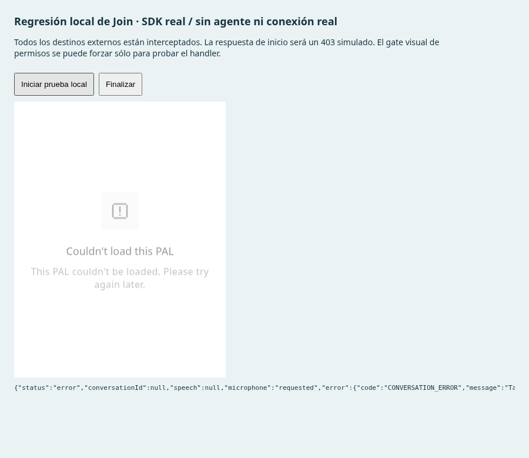

# El agente desaparecía al pulsar Join

Este documento registra la corrección inicial `f5de545`. La [verificación actual](VALIDATION.md) incorpora también la mejora posterior de [disponibilidad y cierre](TAVUS_AVAILABILITY.md).

El SDK de Tavus 0.19.3 puede emitir `conversation-ended` durante la limpieza de un inicio fallido, antes de `CONVERSATION_ERROR`. La integración interpretaba ese evento como una orden de destruir el embed. Desmontaba el agente antes de que pudiera mostrar su pantalla de error o completar su propia recuperación.

Ahora los eventos de error y de fin conservan el componente oficial. Un `ended` anterior a la primera conexión no se presenta como una llamada completada. Finalizar, sustituir explícitamente la sesión, salir de la página o un fallo estructural de inicialización sí liberan el componente. Las herramientas pendientes se cancelan por intento; una respuesta o promesa del intento anterior no puede afectar a un reintento dentro del mismo embed. No hay reintentos automáticos de la aplicación.

## Comprobaciones

- **227/227 casos Node** y compilación de producción correctos. Los 24 casos de sesión incluyen seis regresiones nuevas para este fallo y sus variantes.
- **8/8 grupos del navegador de la presentación**, con cero errores JavaScript. Las pruebas con doble del SDK verifican que su ventana sigue visible después del fallo, que Finalizar queda disponible y que el reintento recupera las herramientas en escritorio y móvil. [Informe](browser-validation.json).
- **SDK real, handler real de Join, red simulada**: fixture de inicialización y rechazo HTTP 403 controlado. La traza reproduce `connecting → disconnecting → conversation-ended → ended → error → unavailable`. El embed permanece montado y Finalizar lo retira. [Informe con la corrección](join-sdk-browser-validation.json).
- La misma prueba con el módulo de la versión anterior `782b8dd` falla de forma esperada: el embed desaparece en `conversation-ended`, antes del error. Se sustituyó sólo la respuesta local del módulo, sin modificar el checkout. [Informe de contraste](join-baseline-browser-validation.json).



La prueba del SDK intercepta todos los destinos HTTP y WebSocket externos antes de cargarlo. Sólo hay un POST de inicio, respondido localmente; los recursos de Daily se bloquean. Para alcanzar el handler Join sin cargar la infraestructura de medios se fuerza exclusivamente el atributo DOM `disabled` de ese botón, y se declara en el informe. No se falsifican eventos del SDK ni se comprueban permisos de un micrófono físico, avatar, audio o una conexión satisfactoria. El 403 es una fixture de regresión y no establece el motivo del fallo en el dominio del usuario.

## Reproducir

```sh
node --test --test-isolation=none tests/demo-tavus-session-model.test.mjs
node tests/demo-tavus-join-browser.mjs
```

La segunda orden levanta y cierra su propio servidor Vite local. `CHROMIUM_PATH`, `JOIN_QA_PORT` y `JOIN_QA_DIR` permiten elegir navegador, puerto y destino de los informes. `JOIN_SESSION_FIXTURE` permite comparar otra copia local del módulo de sesión; el valor predeterminado prueba el código actual. La conversación real y los permisos del dominio de producción siguen pendientes de validación.
