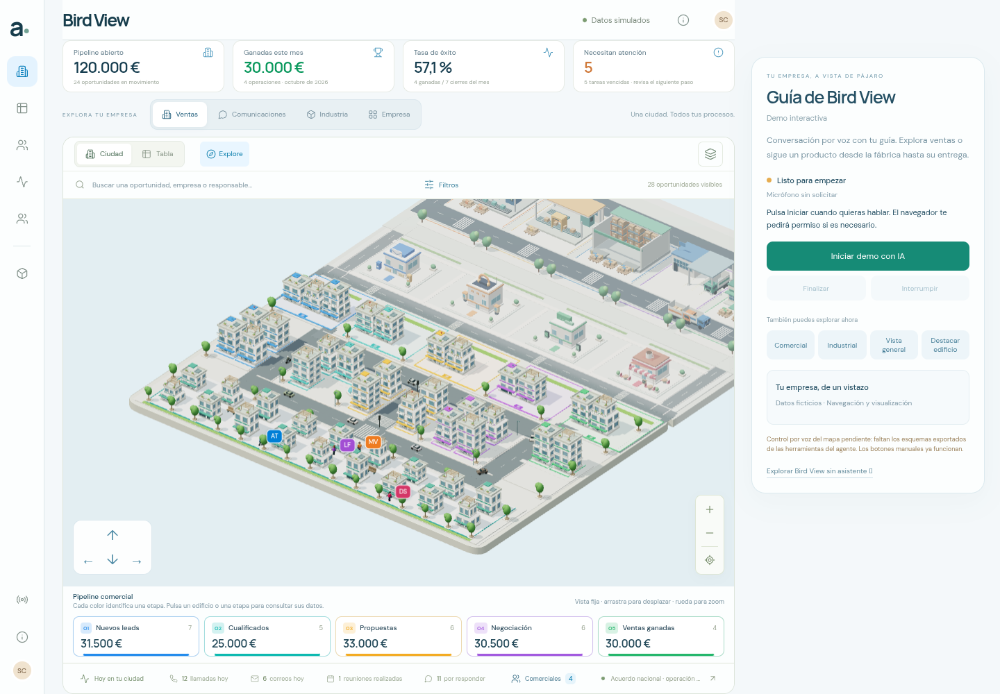
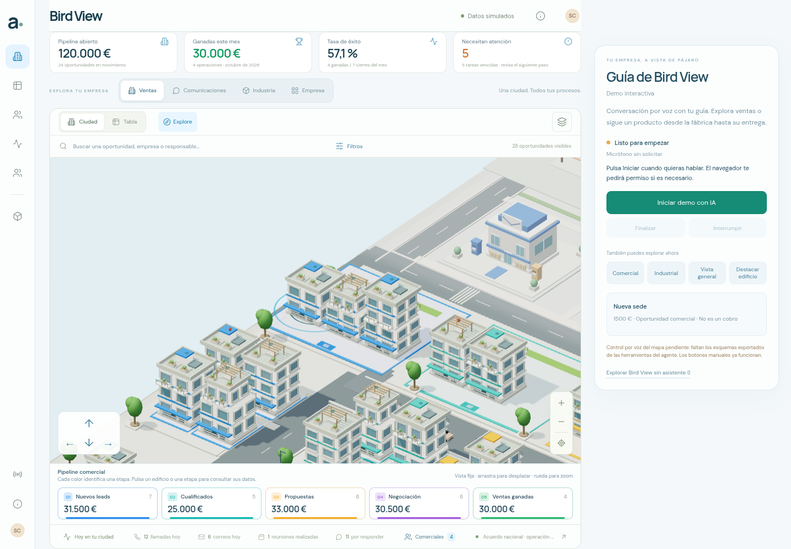
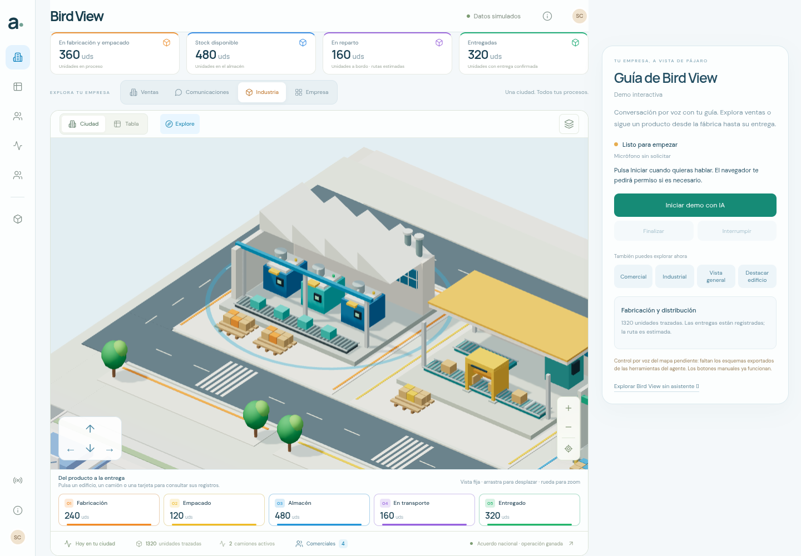

# Bird View · Demo Tavus

Se completaron **195 pruebas automáticas** y **6 grupos de navegador** en la compilación final. La página `/demo` presenta la ciudad real y sus controles manuales, con el Deployment ID público facilitado por el usuario ya configurado y el botón de inicio habilitado. Esta ejecución no inicia una conversación. Los esquemas de las herramientas del agente siguen pendientes.



## Navegador

Se utilizó Chromium **154.0.8037.57**, en 1440 × 1000 y con móvil emulado de 390 × 844, con WebGL2 y ANGLE/SwiftShader por software. Las imágenes son capturas reales del navegador. No se midieron FPS nuevos ni se probó un teléfono físico.

Los seis grupos pasaron con **cero errores JavaScript no capturados**:

1. Acceso directo por HTTP a `/demo`, con ciudad renderizada, estado «Listo para empezar» e **Iniciar demo con IA** habilitado. Finalizar e Interrumpir permanecen deshabilitados; la sesión está en `idle` y el micrófono sin solicitar. El bundle recibido por HTTP contiene el Deployment ID público esperado. No se pulsa Iniciar ni aparece una conexión o avatar ficticios.
2. Botón **Comercial**: encuadre real de `deal-001`, «Nueva sede», y halo visible. El panel muestra sus 1.500 € como oportunidad comercial y aclara que no es un cobro.
3. Botón **Industrial**: encuadre y halo de fabricación. Las 1.320 unidades trazadas se mantienen; la interfaz identifica la ruta como estimada.
4. Botón **Vista general**: regreso a toda la empresa. Los componentes del cuaternión de cámara conservan su orientación dentro de `0,00001` durante los tres encuadres.
5. Ruta principal `/`: conserva el asistente V5 visible y la navegación a comunicaciones. No carga el módulo de la demo ni los SDK Tavus, no registra sus componentes y no solicita la configuración Tavus. Es una comprobación dirigida de regresión; no se repitió aquí toda la suite V5.
6. Móvil de 390 px: guía y controles dentro del ancho disponible, sin desplazamiento horizontal; botón de inicio habilitado y de 44 px de altura. El encuadre industrial funciona y el mapa completo puede verse mediante desplazamiento vertical.

En cada navegación se comparan las instantáneas serializadas del CRM y de la industria: **no cambian los registros**. Los botones manuales actúan sobre el controlador de presentación, no se atribuyen a una conversación de IA.

La suite instrumenta `getUserMedia`, `HTMLMediaElement.play` y la creación de `AudioContext`: las tres cuentas quedan a cero. No se monta ningún `tavus-widget` ni `tavus-embed`, no aparecen elementos de audio/vídeo y no se realizan peticiones a `tavusapi.com`, `tavus.io`, `tavus.com`, `tavus.dev` ni `daily.co`, incluidos sus subdominios. En `/demo` sí se importan los SDK oficiales y se registran ambos componentes, conforme a su instalación; registrar el componente no inicia una conversación. La ruta `/` no los registra ni descarga `app-ytn8nZM7.js`, el módulo que los contiene.





La revisión inicial encontró un botón móvil de 42 px y un halo industrial oculto por la plataforma de la fábrica. Se corrigieron el tamaño táctil, la composición móvil y el perímetro/altura del halo antes de repetir los seis grupos completos. No se cuentan los intentos iniciales incompletos como grupos adicionales.

[Móvil: guía y controles](captures/demo-mobile-ready-industry.png) · [Móvil: mapa tras desplazarse](captures/demo-mobile-industrial-city.png) · [Ruta principal conservada](captures/normal-city-v5-preserved.png).

[Informe de navegador](browser-validation.json). Conserva los SHA-256 de los módulos JS y CSS realmente recibidos por HTTP, incluidos `app-ytn8nZM7.js`, `app-IKnRg8DU.js` y `app-DMQpJPKC.css`. Los hashes de todas las fuentes incluidas coinciden al comenzar y terminar la ejecución final, incluida `.env.production`; `.env.local` no se incluye en los hashes ni en el informe. Todos los assets registrados respondieron con HTTP 200. El informe registra el ID público esperado, comprueba su presencia en el bundle servido y deja constancia de `startButtonClicked: false`.

## Modelos, contratos y sesión

`npm test` pasó sus 20 archivos, y la compilación de producción terminó correctamente. Se ejecutaron además los mismos archivos con `node --test --test-isolation=none`, que enumeró **195/195 casos**, sin fallos ni casos omitidos. Incluyen 12 pruebas del controlador de presentación, 18 de contratos/API y 18 del ciclo de sesión.

Las pruebas del controlador verifican IDs existentes, cola acotada, serialización, cancelación, prioridad a la navegación manual, restauración y ausencia de escrituras CRM/ERP. Las de contratos validan esquemas, bindings explícitos, argumentos y límites; sus esquemas son **fixtures sintéticos de prueba**, no los del agente del usuario. Las de sesión usan un widget controlado para comprobar inicio, estado, errores, deduplicación de herramientas, interrupción y limpieza. No acreditan el comportamiento de un deployment real.

La configuración del handler `/api/tavus-config` se comprueba con respuestas y variables de entorno controladas, incluida la ausencia de credenciales en su salida. También se invocó el handler local con `--env-file=.env.local`: devolvió GET 200, el ID público exacto y contratos pendientes. El servidor estático `vite preview` de esta ejecución no ejecuta las funciones serverless: la página obtiene HTML de fallback en esa ruta, detecta que no es configuración JSON y utiliza el ID público compilado desde `.env.production`. No se ha validado el endpoint publicado de Vercel desde el navegador.

## Pendiente de conexión real

El usuario proporcionó el snippet del widget con Deployment ID `d7770b89-ab37-4445-b065-2a5150e2e4cb`. La comprobación pública de `/init` devolvió HTTP 200, «Guía de Bird View Widget» e `is_available: true`; confirma la disponibilidad de la publicación, no una conversación ni sus dominios permitidos. La exportación de las tres herramientas del agente existente sigue pendiente; véase [configuración y lectura pública del deployment](SETUP.md).

No se han verificado una conversación real, audio bidireccional, saludo, interrupciones de voz, permisos en un dispositivo físico ni llamadas reales de herramientas del agente. Las capturas no contienen un avatar, voz o conexión simulados. Los controles por voz seguirán pendientes hasta revisar los esquemas reales; véase [contratos de herramientas](TOOL_CONTRACTS.md).

## Reproducir

```sh
npm test
npm run build
npm run preview -- --port 4173 --strictPort
```

En otra terminal, con una única sesión de navegador:

```sh
npm run test:demo
```

`BASE_URL`, `CHROMIUM_PATH` y `CAPTURE_DIR` permiten cambiar el servidor, Chromium y el destino de las evidencias. Por defecto, la suite resuelve el ID público esperado con `loadEnv("production", process.cwd(), "VITE_")`. `EXPECT_TAVUS_DEPLOYMENT_ID` permite sustituirlo; una cadena explícitamente vacía selecciona las comprobaciones de configuración ausente. Para ese modo hay que servir una compilación sin ID y un servidor que tampoco lo publique. La suite nunca pulsa Iniciar ni crea automáticamente una conversación.

```sh
# Sólo para comprobar una compilación sin configuración:
VITE_TAVUS_DEPLOYMENT_ID='' npm run build
EXPECT_TAVUS_DEPLOYMENT_ID='' npm run test:demo
```
