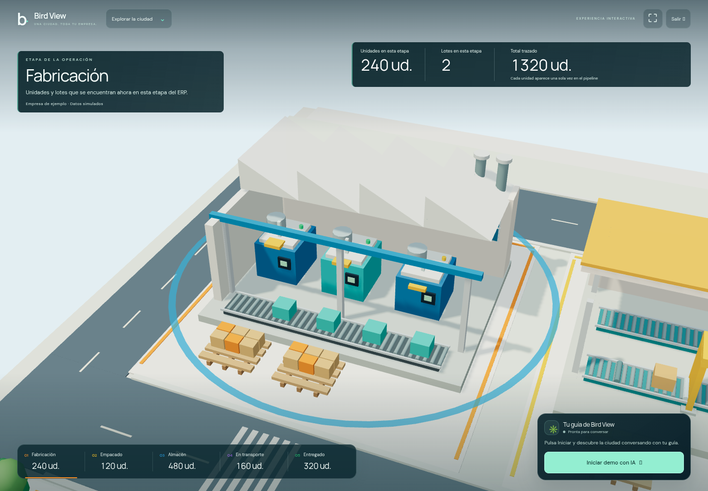
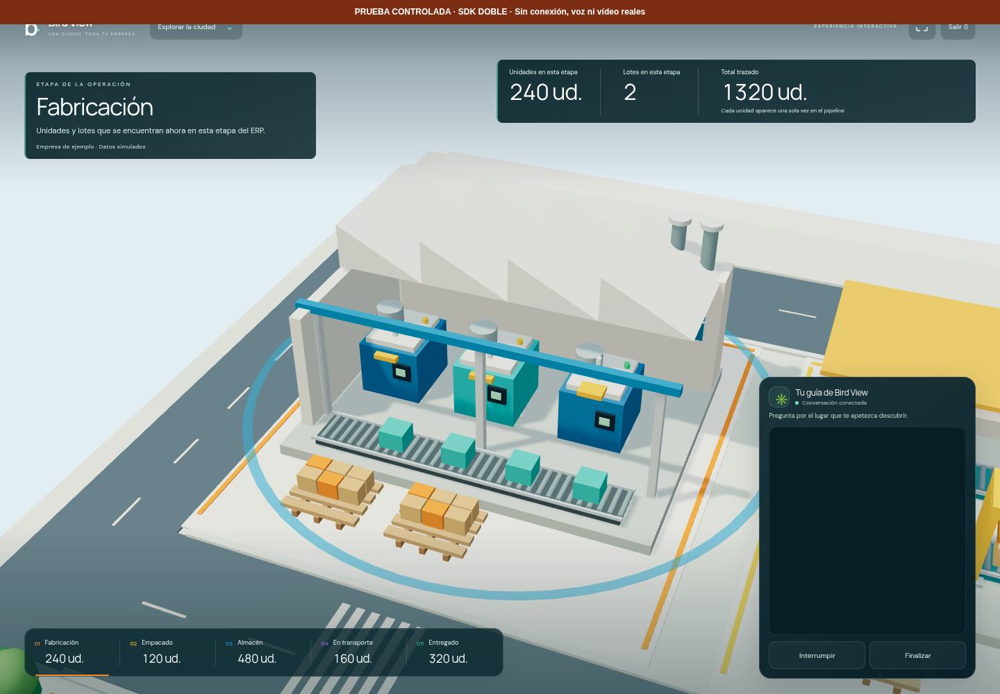

# Bird View · Presentación inmersiva

**221 casos Node y 8 grupos de navegador pasan**, con cero errores JavaScript no capturados. La compilación de producción terminó correctamente. `/demo` muestra la ciudad a pantalla completa con cámara de perspectiva, rótulos e indicadores por toma y el guía en una esquina. La ruta `/` conserva el dashboard y la cámara fija.



## Composición y recorridos

La comprobación utiliza Chromium 154.0.8037.57 y WebGL2 con ANGLE/SwiftShader por software. Escritorio: 1440 × 1000; móvil emulado: 390 × 844 y 844 × 390. Son capturas reales del renderer. No se midieron FPS nuevos ni se probó un teléfono físico.

Los seis primeros grupos verifican:

1. El canvas ocupa exactamente el viewport, sin menú lateral, cabecera del dashboard, buscador, filtros, fichas ni controles de trabajo visibles. Iniciar está habilitado; sin clic no se montan medios ni se inicia una sesión.
2. Plano comercial con perspectiva, indicadores obtenidos de la instantánea y cinco etapas etiquetadas. Su orientación difiere del plano general.
3. Acercamiento a fabricación y halo visible. Se muestran 240 unidades en fabricación y 1320 trazadas, sin duplicar las cargas de los camiones.
4. Plano de reuniones y regreso a vista general: cambian títulos e indicadores de acuerdo con el objetivo. Los registros del CRM y ERP permanecen idénticos.
5. La ruta principal conserva cabecera, asistente V5 y cámara ortográfica con orientación fija. No carga ni registra los componentes Tavus ni solicita su configuración.
6. En móvil vertical y horizontal el canvas sigue ocupando toda la ventana, sin desplazamiento horizontal o vertical del documento; el dock queda dentro del viewport, abajo a la derecha. El botón de inicio conserva 44 px de altura.

[Plano general](captures/immersive-desktop-ready.png) · [Comercial](captures/immersive-sales-cinematic-plan.png) · [Comunicaciones](captures/immersive-communications-cinematic-plan.png) · [Móvil vertical](captures/immersive-mobile-portrait-city-and-guide.png) · [Móvil horizontal](captures/immersive-mobile-landscape-city-and-guide.png) · [Aplicación normal](captures/immersive-regression-normal-city-fixed-map.png).

La primera captura detectó detalles y notas de bajo contraste sobre el fondo claro. Se añadieron velos locales detrás de los rótulos e indicadores y se ajustó el espacio del pipeline móvil antes de completar la ejecución final. Las capturas enlazadas corresponden a esa compilación corregida.

## Herramientas y ciclo de sesión

Otros dos grupos, uno en escritorio y otro en móvil, emplean un **elemento Tavus inerte que actúa como doble del SDK**. La prueba intercepta el registro de sus componentes antes de cargar la página; crea el tag literal `tavus-embed`, con métodos y eventos locales. No instancia el SDK real ni abre una sala. Así se ejercita el contenedor y sus reglas CSS reales, incluidos los 300 px de reserva en escritorio y la adaptación en móvil.

Ambos grupos verifican la aplicación, los esquemas exportados reales, el puente y la escena WebGL:

- Inicio mediante clic y contexto con los parámetros originales y el catálogo: 82 movimientos, 55 edificios y 57 animaciones.
- `movement_id: "industry-stage:manufacturing"`: desplazamiento real y cambio de orientación en perspectiva.
- `building_id: "industry-stage:manufacturing"` y `animation_id: "pulse:industry-stage:manufacturing"`: halo visible.
- `animation_id: "machinery"`: respuesta `already_running`; las matrices de la cinta cambian entre fotogramas sin avanzar la producción.
- Un campo requerido ausente devuelve `TOOL_ARGUMENTS_INVALID`; un edificio desconocido devuelve `TOOL_BINDING_UNRESOLVED`.
- Finalizar restaura cámara e indicadores y termina/destruye el doble una sola vez. Las instantáneas serializadas del CRM y ERP no cambian.
- En móvil se cambia de vertical a horizontal y viceversa sin montar otra sesión; el dock y el elemento inerte siguen dentro de la ventana.



[Doble en móvil vertical](captures/immersive-qa-inert-embed-mobile.png) · [Doble en móvil horizontal](captures/immersive-qa-inert-embed-mobile-landscape.png).

Todas las imágenes con doble llevan un rótulo explícito. La zona vacía del embed comprueba su reserva de espacio; **no acredita el vídeo, los controles internos ni la conversación real de Tavus**. El estado conectado de esas imágenes procede del doble.

## Modelos, red y trazabilidad

Los mismos archivos del script de pruebas se ejecutaron con `node --test --test-isolation=none`: **221/221 casos**, sin fallos ni omitidos. Incluyen once casos nuevos de indicadores y estados de presentación y cinco de geometría de cámara, además de los contratos, controlador y ciclo de sesión existentes. Se verifican cifras comerciales y unidades industriales separadas, datos ausentes, planos dentro del encuadre, altura segura y conservación de la cámara normal.

Durante la suite de navegador hubo **cero solicitudes** a `tavusapi.com`, dominios Tavus y `daily.co`, incluidos subdominios, y sus rutas están bloqueadas por la prueba. Cero llamadas a `getUserMedia`, reproducción multimedia o creación de `AudioContext`. Se registran dos inicios con doble y `realSdkStartButtonClicked: false`.

El [informe completo](browser-validation.json) contiene los ocho resultados, respuestas de herramientas, dimensiones, restauración y SHA-256 de fuentes y assets JS/CSS recibidos por HTTP. Incluye `app-B2nqb3vO.js`, `app-BtAr57pN.js` y `app-0O5U0a0Y.css`, todos con HTTP 200. Las fuentes coinciden al principio y al final de la ejecución; después se contrastaron también con el checkout actual. `.env.production` se incluye; `.env.local` no se incorpora al informe.

Vite preview no ejecuta las funciones serverless. La página utiliza el ID público compilado y los esquemas incluidos; la API y sus overrides se validan en los casos Node. No se ha comprobado el endpoint publicado de Vercel ni una llamada real en el dominio final.

## Pendiente de verificación real

La lectura pública previa del deployment `d7770b89-ab37-4445-b065-2a5150e2e4cb` devolvió HTTP 200 y disponibilidad. No demuestra permisos del dominio final, cuotas al iniciar ni audio bidireccional.

Siguen pendientes una conversación real, saludo hablado, interrupciones de voz, permisos en dispositivo físico y vídeo/controles del embed con Tavus. No se creó ninguna conversación facturable automáticamente. [Configuración](SETUP.md) · [Contratos](TOOL_CONTRACTS.md).

## Reproducir

```sh
npm test
npm run build
npm run preview -- --port 4173 --strictPort
# En otra terminal, con una única sesión de navegador:
npm run test:demo
```

`BASE_URL`, `CHROMIUM_PATH` y `CAPTURE_DIR` permiten cambiar servidor, navegador y destino. El ID esperado se lee con `loadEnv("production", process.cwd(), "VITE_")`; `EXPECT_TAVUS_DEPLOYMENT_ID` permite sustituirlo. Un valor explícitamente vacío comprueba una compilación sin ID y omite los dos grupos con doble. La suite sólo pulsa Iniciar después de instalar el doble y nunca crea una conversación real.

El [informe del diseño anterior](VALIDATION-dashboard.md) y su [JSON histórico](dashboard-browser-validation.json) se conservan como referencia; no describen la composición inmersiva actual.
