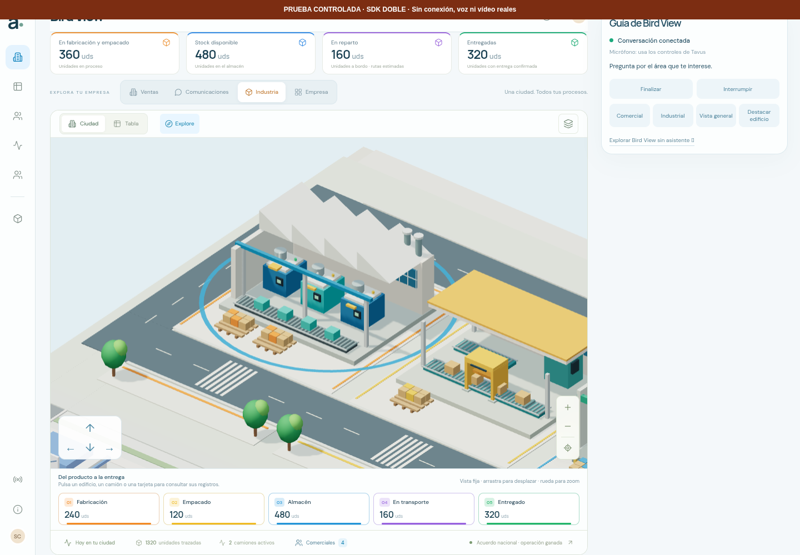

# Bird View · Demo Tavus

La compilación final pasó **205 pruebas de modelos y componentes** y **8 grupos de navegador**: seis comprueban la aplicación sin iniciar sesión y dos ejercitan el puente con un **doble controlado del SDK**. Los tres esquemas reales aportados por el usuario están integrados y el catálogo se genera con las entidades existentes. No se ha iniciado una conversación real de Tavus.


## Aplicación sin sesión

Se utilizó Chromium **154.0.8037.57**, en 1440 × 1000 y con móvil emulado de 390 × 844, con WebGL2 y ANGLE/SwiftShader por software. Las imágenes son capturas del navegador. No se midieron FPS nuevos ni se probó un teléfono físico.

Los seis grupos sin dobles comprueban:

1. Acceso HTTP directo a `/demo`, ciudad renderizada, estado «Listo para empezar» e **Iniciar demo con IA** habilitado. Finalizar e Interrumpir permanecen deshabilitados; la sesión está en `idle` y el micrófono sin solicitar. Los contratos figuran listos y el bundle recibido contiene el Deployment ID público esperado.
2. Botón **Comercial**: encuadre real de `deal-001`, «Nueva sede», y halo visible. Su importe se identifica como oportunidad comercial, no como cobro.
3. Botón **Industrial**: encuadre y halo de fabricación, con sus cantidades reales: 1.320 unidades trazadas y 240 en fabricación. La interfaz identifica la ruta como estimada.
4. Botón **Vista general**: regreso a toda la empresa. La orientación de cámara se conserva dentro de una tolerancia de `0,00001` durante los tres encuadres.
5. Ruta principal `/`: conserva el asistente V5 y la navegación a comunicaciones. No carga el módulo de la demo ni los SDK Tavus, no registra sus componentes y no solicita la configuración Tavus. Es una comprobación dirigida; no se repitió toda la suite V5.
6. Móvil de 390 px: guía y controles dentro del ancho disponible, sin desplazamiento horizontal; botón de inicio habilitado y de 44 px de altura. Funciona el encuadre industrial y el mapa completo puede verse con desplazamiento vertical.

En cada navegación se comparan las instantáneas serializadas del CRM y de la industria: **los registros no cambian**. Los botones manuales no se atribuyen a una orden de voz.


[Encuadre comercial](captures/demo-commercial-readonly-highlight.png) · [Guía móvil](captures/demo-mobile-ready-industry.png) · [Mapa móvil](captures/demo-mobile-industrial-city.png) · [Ruta principal](captures/normal-city-v5-preserved.png).

## Puente con SDK controlado

Los otros dos grupos se ejecutan en contextos separados, uno de escritorio y otro móvil. Antes de cargar la aplicación, la prueba sustituye exclusivamente la creación de `tavus-widget`/`tavus-embed` por un `div` local con métodos y eventos controlados. No se instancia ningún componente real de Tavus. Las solicitudes a Tavus y Daily están además bloqueadas por el navegador de prueba.

Sólo en estos contextos se pulsa Iniciar. El flujo de **la aplicación real** crea su sesión, puente, validadores y controlador de presentación. El doble emite eventos `tavus:conversation-started` y `tavus:tool-call`; ese estado conectado pertenece al doble, no al servicio. Las capturas llevan el rótulo permanente «PRUEBA CONTROLADA · SDK DOBLE · Sin conexión, voz ni vídeo reales».

En ambos tamaños se comprueba:

- El contexto enviado contiene las tres definiciones exactas de `existing-agent-tools.js` y un catálogo idéntico al generado con la instantánea del CRM/ERP: 82 movimientos, 55 edificios/áreas y 57 animaciones.
- `trigger_3d_camera_movement` con `movement_id: "industry-stage:manufacturing"` completa el encuadre del renderer real conservando la orientación.
- `highlight_building` con `building_id: "industry-stage:manufacturing"` y `trigger_animation` con `animation_id: "pulse:industry-stage:manufacturing"` producen el halo visible sobre la fábrica.
- `trigger_animation` con `animation_id: "machinery"` confirma la animación existente con `already_running`. Las matrices de los objetos de la cinta cambian entre fotogramas; no se avanza ningún lote ni se registra producción nueva.
- La ausencia del argumento requerido devuelve `TOOL_ARGUMENTS_INVALID`. Un identificador de edificio no anunciado en el catálogo devuelve `TOOL_BINDING_UNRESOLVED`.
- Finalizar restaura la cámara anterior, cierra y destruye el doble una vez y elimina su `div`. CRM y ERP conservan exactamente sus instantáneas anteriores.



[Prueba móvil del puente con el mismo rótulo](captures/qa-sdk-double-mobile-tool-highlight.png). El `div` no reproduce la reserva de espacio ni la interfaz del avatar embed real: esta comprobación móvil acredita el flujo de eventos y la visualización 3D, **no la composición de un avatar real junto al mapa**.

## Red, artefactos y pruebas Node

Los ocho grupos terminaron con **cero errores JavaScript no capturados**. Las cuentas instrumentadas de `getUserMedia`, `HTMLMediaElement.play` y creación de `AudioContext` quedan a cero. No se montan elementos reales `tavus-widget`/`tavus-embed` ni audio/vídeo, y no se solicitan recursos a `tavusapi.com`, `tavus.io`, `tavus.com`, `tavus.dev` ni `daily.co`, incluidos sus subdominios. En `/demo` sí se importan los SDK oficiales y se registran sus componentes; registrarlos no inicia una conversación.

[Informe de navegador](browser-validation.json). Registra **dos clics de inicio con doble** y `realSdkStartButtonClicked: false`. Conserva los SHA-256 de las respuestas JS/CSS realmente recibidas, incluidos `app-CGN78Dty.js`, `app-D-wTd5vv.js` y `app-DMQpJPKC.css`, todas con HTTP 200. Los hashes de las fuentes coinciden al comenzar y terminar, incluida `.env.production`; `.env.local` no se incluye en los hashes ni en el informe. Los resultados controlados se identifican con `CONTROLLED_SDK_DOUBLE_NOT_A_TAVUS_CONVERSATION`.

La compilación de producción terminó correctamente. Los archivos del script `npm test` se ejecutaron también con `node --test --test-isolation=none`: **205/205 casos**, sin fallos ni omitidos. Cubren contratos reales, catálogo acotado, validación de IDs, cola, cancelación, restauración, deduplicación y limpieza. Los fixtures sintéticos anteriores siguen utilizándose para casos genéricos; no sustituyen las definiciones reales recibidas del usuario. Los esquemas reales se conservan sin añadir enums ni prohibiciones de campos extra que no estaban en el export. La selección de acciones permitidas se aplica después mediante los bindings del catálogo.

La API `/api/tavus-config` se prueba con respuestas y variables controladas, incluida la ausencia de credenciales en su salida y el rechazo de overrides inválidos. Su configuración predeterminada indica `contractSource: "bundled"`; el cliente vincula las definiciones reales a su instantánea. `vite preview` no ejecuta funciones serverless: en estas pruebas devuelve HTML de fallback en esa ruta y el cliente utiliza el ID público compilado y los contratos incluidos. No se ha validado el endpoint publicado de Vercel desde este navegador.

## Alcance pendiente

El usuario facilitó el Deployment ID `d7770b89-ab37-4445-b065-2a5150e2e4cb`. Su lectura pública de `/init` respondió HTTP 200, «Guía de Bird View Widget» e `is_available: true`; confirma la disponibilidad de la publicación, no una conversación ni los dominios permitidos de la web final. Véase [configuración](SETUP.md) y [contratos](TOOL_CONTRACTS.md).

Siguen sin comprobarse con Tavus real la conversación, audio bidireccional, saludo, interrupciones de voz, permisos en un dispositivo físico y llamadas espontáneas de herramientas del agente. No se ha creado una llamada facturable. Las dos pruebas del SDK doble demuestran el puente local y sus resultados visuales; no acreditan esos comportamientos del servicio.

## Reproducir

```sh
npm test
npm run build
npm run preview -- --port 4173 --strictPort
```

En otra terminal, con una única sesión de navegador:

```sh
npm run test:demo
```

`BASE_URL`, `CHROMIUM_PATH` y `CAPTURE_DIR` permiten cambiar servidor, Chromium y destino. El ID esperado se obtiene con `loadEnv("production", process.cwd(), "VITE_")`; `EXPECT_TAVUS_DEPLOYMENT_ID` permite sustituirlo. Una cadena explícitamente vacía selecciona seis grupos sin configuración y omite los dos de SDK doble. Para ese modo deben servirse una compilación sin ID y un servidor que tampoco lo publique:

```sh
VITE_TAVUS_DEPLOYMENT_ID='' npm run build
EXPECT_TAVUS_DEPLOYMENT_ID='' npm run test:demo
```

La suite sólo pulsa Iniciar después de instalar el doble local y bloquea los dominios Tavus/Daily en todos sus contextos. No inicia automáticamente una conversación real.
