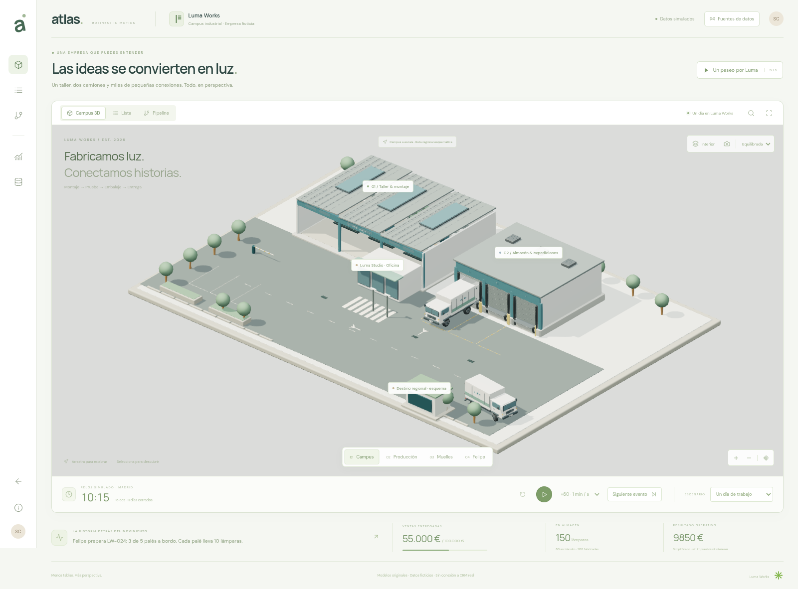
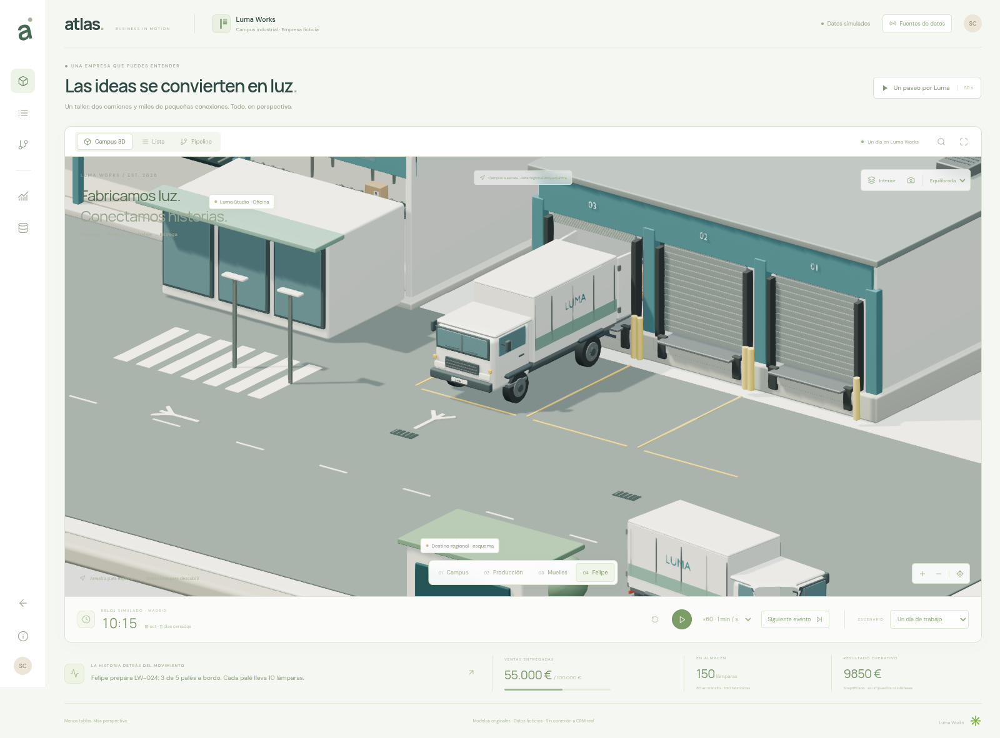
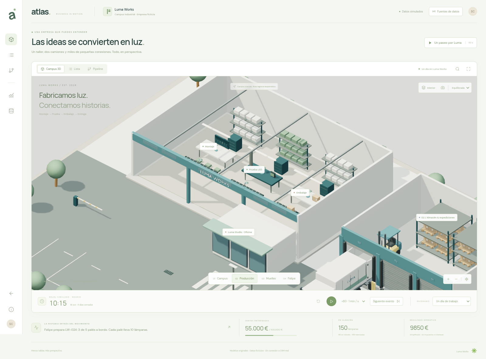
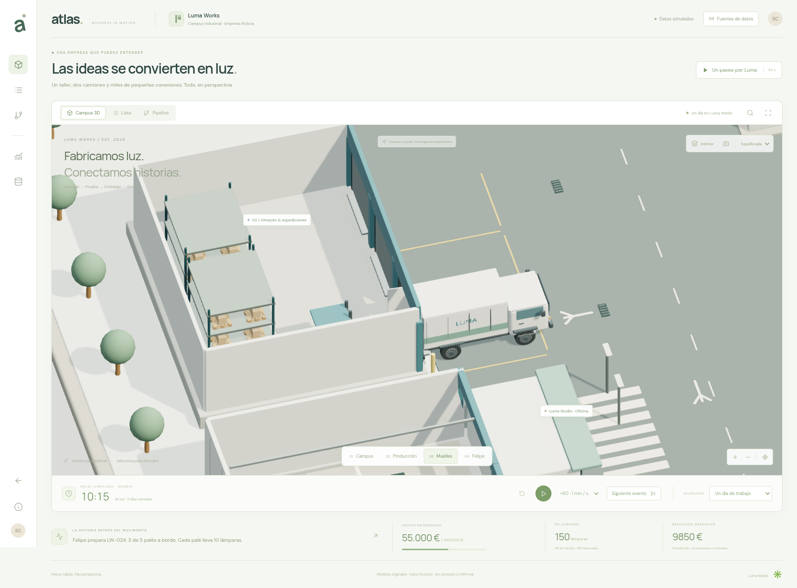
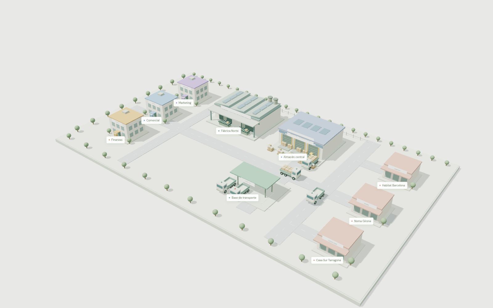
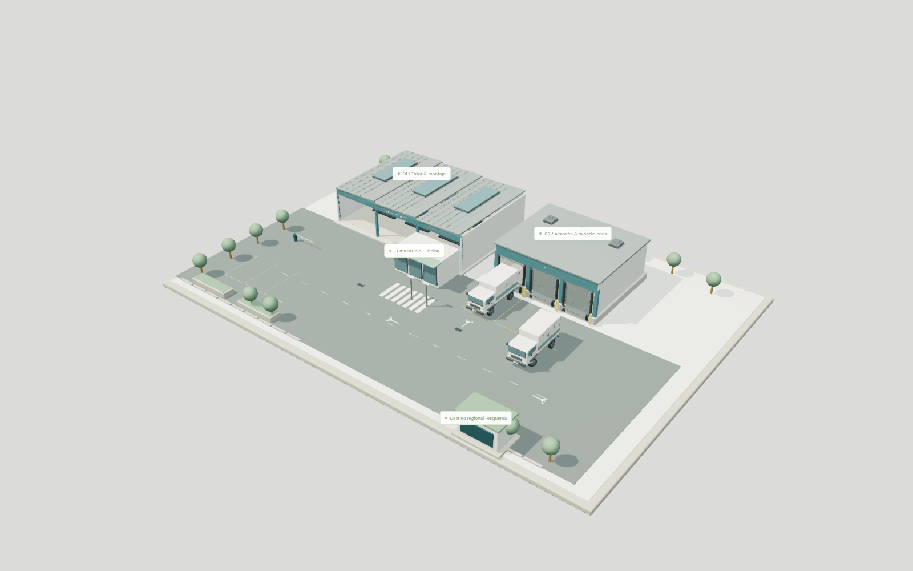

# Evidencia real · Luma Works

Capturas del renderer de la aplicación y grabación real de Chromium. No son imágenes generadas ni renders externos presentados como producto. Los modelos están disponibles localmente en el repositorio.

## Campus y detalle

Más vistas: [preset ligero](captures/light.png), [preset alto](captures/high.png), [móvil emulado](captures/mobile.png).

**[Ver o descargar la secuencia real de navegador](captures/luma-demo.mp4)** · aproximadamente 20 segundos, 1280 × 800, preset ligero. Capturada mediante CDP y codificada por el FFmpeg instalado, conservando timestamps de los frames; no se fabricaron frames de una animación externa. Está condicionada por la baja cadencia de SwiftShader, no demuestra fluidez en una GPU física. El mecanismo estándar de vídeo de Playwright no pudo descargar su FFmpeg por la política de red; la captura CDP usa herramientas locales sin omitir verificaciones. Metadatos: [video-capture.json](video-capture.json).

## Comparación con la versión anterior

Misma cámara perspectiva (34°), posición (51, 55, 66), objetivo (1, 0, 1), viewport 1600 × 1000. Se comparan dos distribuciones y escalas de campus distintas; no es una prueba de velocidad entre motores.

| Atlas operativo anterior              | Campus Luma Works                      |
| ------------------------------------- | -------------------------------------- |
|  |  |

Las capturas muestran el producto ejecutándose, no solo una compilación. Se revisaron campus, interior, muelles, camión, seguimiento, móvil y presets. Se corrigieron salientes del tejado, apoyo de mercancía, plataforma plegable, ubicación del cliente y etiquetas obsoletas al cambiar de cámara.

## Comprobaciones funcionales

- **Instalación reproducida:** `npm ci --cache /tmp/atlas-npm-cache` con versiones directas fijadas. Una única copia de Three.js 0.180.0 (`npm ls three`).
- **Build:** `npm run build` correcto. Vite advierte de un chunk compartido de más de 500 kB sin minificar; no impide compilar. No se ha silenciado la advertencia.
- **24 pruebas de modelos** (`npm test`) correctas: 13 de Luma y 11 del modelo operativo anterior. Incluyen conservación después de todos los eventos en cuatro escenarios, idempotencia, capacidades, stock no negativo, venta/coste sin cobro automático, retorno, ETA sin confirmación, costes de la vuelta, cierres diarios/mensuales, pausa y velocidades equivalentes.
- **Prueba de navegador Luma:** selección real por raycasting, identidad de meshes estable, pedido/carga, retorno, llegada pendiente, relaciones, lista/pipeline, cierres económicos, permisos de demo, cubiertas, cuatro encuadres, proyecciones, filtros, pausa/velocidad, presets y viewport móvil. Sin errores JS en el recorrido verificado.
- **Rutas:** 1.028 muestras sobre las cuatro curvas reales, comprobando un envolvente de vehículo de 2,8 × 6,5 m contra el edificio del destino. Cero intersecciones en esa comprobación. Es una validación del guion concreto, no un motor general de colisiones o navegación.
- **Regresión:** `npm run test:operations` y `npm run test:classic` correctos. El Atlas anterior sigue accesible.
- **Sin WebGL:** Chromium con WebGL desactivado conserva lista (42 registros), selección y controles de eventos. El aviso de 3D no tapa la lista.
- **Móvil:** 390 × 844 en Chromium, sin desbordamiento horizontal. No equivale a validar un teléfono físico.

### Dos comprobaciones contables

| Cierre           |    Ventas | Coste producto |   Rutas |    Fijos | Resultado operativo | Stock terminado |
| ---------------- | --------: | -------------: | ------: | -------: | ------------------: | --------------: |
| Día operativo 12 |  60.000 € |       28.800 € | 2.400 € | 18.000 € |            10.800 € |             200 |
| Mes base         | 100.000 € |       48.000 € | 4.000 € | 30.000 € |            18.000 € |             200 |

Los resultados son operativos simplificados, no beneficio neto. Las entregas no generan cobros automáticamente. No se ha modelado un saldo de caja.

## Renderer

La prueba r180 confirma la ruta de nodos con el backend WebGL2 de WebGPURenderer. El WebGPU nativo pierde el dispositivo en este entorno al esperar el trabajo de la GPU. Se entrega WebGLRenderer. El experimento, su resultado y su limitación están documentados en [IMPLEMENTATION.md](IMPLEMENTATION.md) y [renderer-probe.json](renderer-probe.json). No se deduce que WebGPU falle universalmente.

## Rendimiento medido

**Entorno:** Linux, HeadlessChrome 154, ANGLE/Vulkan **SwiftShader**, render por software; viewport 1920 × 1080, DPR del dispositivo 1. No hay medición en una GPU de escritorio ni portátil físico. La escena ocupa 1764 × 724 píxeles CSS en esa prueba. El init de escena registrado fue aproximadamente 909 ms desde la evaluación del módulo (con servidor/caché local); no es LCP ni tiempo de carga por Internet.

Se midieron intervalos entre callbacks de frames renderizados, no solo tiempo CPU de enviar comandos. Las cifras de cadencia siguientes son observaciones **del entorno headless**, no FPS físicos de pantalla ni una garantía de producto. Los aproximadamente 3–5 ms de envío CPU no se presentan como 200–300 FPS: los intervalos reales aquí fueron muy superiores.

### Revisión del campus final (12 muestras por preset, después de calentamiento)

| Preset      | Resolución interna | DPR efectivo | Mediana de frame | p95 de frame | Cadencia observada | Draw calls* | Triángulos* |
| ----------- | ------------------ | -----------: | ---------------: | -----------: | -----------------: | ----------: | ----------: |
| Equilibrado | 1764 × 724         |            1 |           867 ms |       904 ms |      1,16 frames/s |         470 |     375.602 |
| Ligero      | 1323 × 543         |         0,75 |           474 ms |       568 ms |      2,09 frames/s |         470 |     375.602 |

*Contadores acumulados de todos los passes del frame, incluidas sombras. No son solo geometría única. La muestra es pequeña; el p95 no es una garantía estadística. Se conservan los números originales y el hash de fuente usado para la medición en [performance.json](performance.json). Los últimos cambios de etiquetas y visibilidad de la lámpara parcial no alteran esta conclusión de rendimiento.

El preset alto se midió también durante el ajuste con 30 muestras, DPR 1 y 4096 de shadow map: mediana 2068 ms, p95 2324 ms y aproximadamente 732 draw calls incluyendo AO/sombras. Las mediciones intermedias se conservan en el JSON, separadas de la revisión final. Supera el presupuesto orientativo de calls cuando se cuentan todos los passes; no se oculta ese coste.

**Los objetivos de 60 FPS / 30 FPS no están acreditados.** En SwiftShader no se alcanzan. Es necesario medir posteriormente en equipos de referencia con aceleración gráfica real. El preset ligero reduce primero resolución/AO/sombras y conserva el detalle de los modelos. En pausa se renderiza bajo demanda; el loop no dibuja continuamente una escena invariable.

Assets GLB/HDR originales: **2.818.509 bytes** (~2,82 MB decimales), sin compresión adicional Meshopt/KTX2 ni descargas externas. Este es el tamaño de los archivos, no una estimación comprimida de red. Las fuentes y el bundle de código son adicionales. [Manifiesto completo con hashes](asset-manifest.json).

## Límites que permanecen

Faltan backend/OAuth y conectores reales CRM/ERP/TMS/GPS, permisos de servidor, validación en dispositivos físicos y optimización medida en GPU de referencia. La capacidad de estiba es nominal; no hay simulador volumétrico ni solver físico de tráfico general. Las rutas y las reservas pertenecen al escenario determinista. Los snapshots económicos cumplen las reglas ficticias de la demo, no una contabilidad de producción completa.
