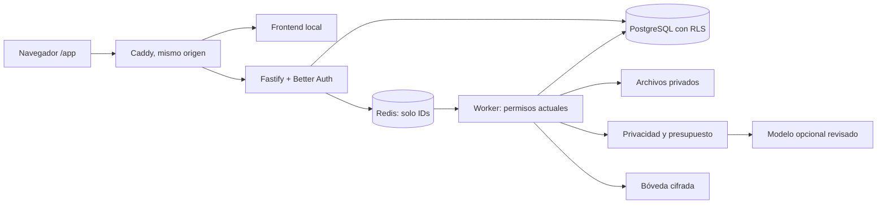

# Arquitectura

Monorepo TypeScript estricto. `apps/web`: React/Vite, Router, TanStack Query, Radix Dialog, Tailwind, Lucide y Recharts. `apps/api`: Fastify, Better Auth y Zod. `apps/worker`: BullMQ. PostgreSQL conserva entidades y resultados; Redis conserva la cola. El HTML aportado es referencia visual: su bundle no se ejecuta.

## Datos y permisos

`organization` es un cliente de BirdView; `account` es una cuenta comercial de esa empresa. Las membresías ligan usuario, organización, rol y departamentos. La sesión mantiene la organización activa y el servidor la contrasta en cada solicitud. El navegador cancela peticiones, vacía cachés y remonta el espacio al cambiar de organización o versión de autorización.

Las entidades llevan organización, ID, departamento, propietario, clasificación, JSON tipado en los servicios, versión y fechas. Las referencias a cuentas, facturas, pipelines, fases, productos, conversaciones y tareas incluyen organización. Hay índices por organización/departamento y unicidad por origen. Importadores y mutaciones usan esquemas cerrados. Las migraciones SQL son la autoridad para RLS y restricciones; Drizzle expone conexión y esquema.

`birdview_runtime` no es dueño, superusuario ni BYPASSRLS. Cada transacción vuelve a resolver permisos y usa `SET LOCAL`; sin contexto válido no devuelve filas. El servidor rechaza un rol privilegiado. `birdview_auth` accede al directorio de identidad sin SELECT de negocio. `birdview_vault` solo ejecuta funciones acotadas, sin listar mappings. El rol de migración solo se entrega al servicio inicializador.

## Una definición de cada indicador

Chat, briefing, ciudad, informes y API comparten `packages/analytics`. 123456 representa 1.234,56 EUR: importes enteros en unidades menores, sin conversión implícita entre monedas. Saldo = total − pagos − abonos, excluyendo anuladas. Facturación, ventas ganadas y cobros son distintos. Tasa de cierre = ganadas / (ganadas + perdidas) de la cohorte de cierre; denominador vacío da N/A.

Los filtros explican a qué fecha se aplican. No se presenta un saldo actual como histórico reconstruido ni se inventa actividad anterior a la cobertura. Las lecturas tienen límites explícitos. La ciudad recibe un modelo autorizado, sin cálculos duplicados en el cliente: solo módulos habilitados con datos accesibles. La altura es decorativa y así se indica. El SVG de `/app` es independiente de la ciudad Three.js y presentación anteriores.

## Persistencia y trabajos

La API guarda antes de encolar. La cola contiene solo IDs y versión de autorización. Los workers revalidan antes de leer y publicar. IDs estables de jobs, rutinas y archivos evitan duplicados. El scheduler recupera solicitudes `queued` que una API interrumpida no encoló; BullMQ recupera locks interrumpidos. Las pruebas incluyen reinicio en un punto de generación persistido.

Rutinas: horario IANA/Intl, ventana reciente de 60 minutos, horas inexistentes de DST omitidas y repetidas con una sola clave local. Producen tareas internas o informes; no envían emails. No se ejecutan semanas de atrasos después de una parada prolongada.

Los informes conservan snapshot, HTML escapado, CSV seguro y PDF de Chromium con scripts y red bloqueados. Los objetos nunca son públicos y cada descarga verifica propietario, caducidad, departamentos, permisos y versión actual.

La versión de autorización es global por organización. Un cambio de membresía invalida resultados privados antiguos también para otros usuarios; deben generarse de nuevo. Es una limitación conservadora de experiencia. El conocimiento conserva fuente declarada y versiones. Títulos coincidentes con contenidos distintos quedan pendientes de confirmación y los hechos de origen no se sobrescriben desde una declaración de usuario. No altera cálculos contables. Aprobar/ejecutar solo modifica el sandbox demo; no hay escritura remota.
